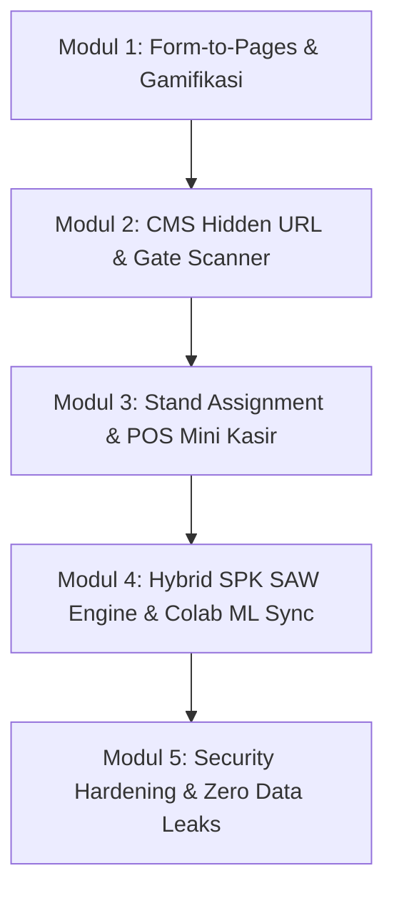

# PATEN – Pemantauan Transaksi & Efektivitas Niaga
### Sistem Digitalisasi Event, POS Kasir Atomik & Evaluasi Bantuan UMKM Terintegrasi SPK SAW dan Machine Learning
#### Kabupaten Kutai Timur, Kalimantan Timur

[](https://laravel.com)
[](https://vuejs.org)
[](https://inertiajs.com)
[](https://supabase.com)
[-brightgreen?style=for-the-badge&logo=php)](docs/CONSOLIDATED_TESTING_REPORT.md)
[](LICENSE)

---

## 1. Tentang Proyek PATEN

**PATEN (Pemantauan Transaksi & Efektivitas Niaga)** adalah platform terpadu yang dirancang khusus untuk memodernisasi ekosistem event, pameran daerah, pasar rakyat, dan bazar UMKM di Kabupaten Kutai Timur. 

Sistem ini menjembatani operasional lapangan secara *real-time* (tiket pengunjung, gate check-in, dan transaksi kasir stan POS mini) dengan proses evaluasi kebijakan bantuan modal usaha berbasis data akurat pada Dinas Koperasi & UKM Kabupaten Kutai Timur.

### Keunggulan & Landasan Regulasi Daerah:
1. **Penerapan Regulasi Perbup Kutim:** Penegakan aturan seleksi bantuan modal usaha secara deterministik, terutama kepatuhan **prinsip 1 KK 1 Penerima bantuan APBD**, verifikasi kepemilikan Nomor Induk Berusaha (NIB), dan afirmasi inklusivitas pelaku usaha disabilitas.
2. **Hybrid SPK SAW & Machine Learning:** Menggabungkan metode Sistem Pendukung Keputusan *Simple Additive Weighting* (SAW) 5 kriteria berbobot objektif dengan klasterisasi *Machine Learning* (K-Means & Random Forest) via Google Colab.
3. **Arsitektur POS Kasir Berkecepatan Tinggi:** Transaksi kasir stan super cepat dengan penguncian tingkat baris (*database row-level lock*) `lockForUpdate()` di dalam transaksi atomik, menjamin integritas data bebas *race condition* dan *lost updates* pada volume transaksi tinggi.
4. **Keamanan & Perlindungan Data Pribadi (UU PDP):** Penerapan URL rahasia berbasis 64-karakter *cryptographic token*, PIN unik terisolasi per stan, pembatasan laju permintaan (*rate limiting* anti brute-force), serta penyensoran mutlak NIK, No KK, dan nomor kontak pada seluruh endpoint publik.

---

## 2. Tech Stack

- **Backend Framework:** Laravel 13 (PHP 8.4+)
- **Database:** Supabase PostgreSQL 17 (Session Pooler & Cloud Relational DB)
- **Frontend Layer:** Inertia.js v2 + Vue 3 (Vite 8)
- **Arsitektur Data:** UUID v4 primary keys (`uuid-ossp`), Eloquent ORM, Atomic Database Transactions
- **Security & Middleware:** Cryptographic 64-character token authorization, Stand PIN isolation middleware, Rate Limiter throttles
- **Machine Learning Pipeline:** Python 3, Scikit-Learn (K-Means Clustering, Random Forest Classifier), Google Colab integration via secure Webhook
- **Testing & Quality Assurance:** PHPUnit automated test suite (44 feature/unit tests, 390 assertions, **100% passing rate**)

---

## 3. Fitur Modular Sistem

Sistem PATEN dibangun secara modular ke dalam 5 modul inti yang saling terintegrasi:



### Modul 1: Form-to-Pages, Skema Warna Dinamis & Gamifikasi Tiket
- Pembuatan event publik mandiri dengan pemilihan skema warna dinamis (*monochromatic* / *duotone*).
- Generator *secure management token* (64 karakter) acak untuk akses CMS panitia tanpa password.
- Halaman publik acara responsif (`/e/{slug}`) memuat profil acara, rundown terstruktur, dan form registrasi tiket mandiri.
- Penerbitan tiket digital unik (*PATEN-DOOR* / *PATEN-HTM*) lengkap dengan QR code SVG instan.
- Proteksi DDoS & spam registrasi menggunakan named rate limiter (30 request/menit).
- Ekspor lembar poster promosi acara beresolusi tinggi dengan QR code registrasi.

### Modul 2: CMS Hidden URL, Rundown CRUD, Stand Generator & Gate Scanner
- Dashboard manajemen panitia aman diakses melalui URL rahasia `/cms/{slug}?token={secret_token}`.
- Manajemen jadwal rundown acara (*real-time status*: Terjadwal, Sedang Berlangsung, Selesai).
- *Batch Stand Provisioning Generator*: Pembuatan stan massal dengan penomoran urut otomatis dan penerbitan PIN kasir 6 digit unik.
- Scanner check-in tiket di pintu masuk gerbang (*Gate Scanner*) dengan deteksi tiket palsu atau duplikat (HTTP 409).
- Mesin pengundian doorprize acak yang secara mutlak hanya mengundi pengunjung yang telah hadir fisik (*checked-in*).

### Modul 3: Stand Assignment Perbup Kutim, Menu CRUD & POS Mini Transaksi Atomik
- Pendaftaran profil UMKM berbasis standar Perbup Kutim: validasi NIK (16 digit), No KK (16 digit), kepemilikan NIB, omzet dasar, dan status disabilitas.
- Autentikasi kasir stan berbasis PIN 6-digit terisolasi tanpa intervensi akun panitia.
- Manajemen katalog menu stan dan ekspor lembar daftar harga menu bertema warna event induk.
- Terminal POS mini kasir cepat: pencatatan transaksi Tunai & QRIS dengan proteksi konkurensi atomik `lockForUpdate()`.
- Isolasi sesi kasir: kasir stan dilarang mengakses kasir stan lain atau menyisipkan menu lintas stan.

### Modul 4: Hybrid SPK SAW Engine, Guardrail 1 KK 1 Penerima & Colab ML Sync
- Mesin SPK SAW (*Simple Additive Weighting*) menghitung skor kelayakan $0.00 - 100.00$ berdasarkan 5 kriteria:
  * Frekuensi Transaksi ($30\%$)
  * Omzet Transaksi ($20\%$)
  * Konsistensi Pelayanan Jam Aktif ($25\%$)
  * Rasio Digitalisasi Pembayaran QRIS ($10\%$)
  * Kelengkapan Legalitas NIB, Halal, P-IRT ($15\%$)
- **Deterministic Guardrail Perbup Kutim:**
  * **1 KK 1 Penerima:** UMKM dengan skor tertinggi dalam satu KK berhak menerima nominasi hibah APBD; anggota KK lainnya dialihkan ke kredit perbankan.
  * **Legalitas NIB:** UMKM tanpa NIB otomatis dialihkan ke fasilitas legalitas dan didiskualifikasi dari kuota prioritas hibah APBD.
  * **Anti-Duplikasi:** UMKM yang sudah pernah menerima bantuan modal dialihkan ke kredit perbankan.
- Webhook sinkronisasi Machine Learning (`POST /api/ml/sync-evaluations`) untuk menerima hasil klasterisasi K-Means dari Google Colab.
- Leaderboard publik keaktifan stan (`/e/{slug}/leaderboard`) dengan sensor total omzet rupiah dan identitas pribadi.

### Modul 5: End-to-End Orchestration, Concurrency Load Test & Security Hardening
- Simulasi integrasi alur hidup lengkap dari inisialisasi acara hingga evaluasi rekomendasi kebijakan dinas.
- Uji beban konkurensi 25x transaksi simultan berurutan membuktikan keandalan akumulasi omzet tanpa *lost updates*.
- Audit kepatuhan UU PDP: zero data leaks pada seluruh endpoint publik dan terminal kasir.
- Proteksi brute force PIN kasir stan dengan respons HTTP 429 *Too Many Requests*.
- Penyembunyian otomatis `secure_management_token` pada seluruh serialisasi JSON publik.

---

## 4. Panduan Instalasi & Setup Lingkungan

### Prasyarat Sistem
- **PHP:** Versi 8.4 atau lebih baru (dengan ekstensi `pdo_pgsql`, `mbstring`, `openssl`, `curl`)
- **Composer:** Versi 2.x
- **Node.js:** Versi 22.x atau 24.x & **NPM**
- **Git**
- **Akses Database Supabase PostgreSQL 17** (atau instance PostgreSQL lokal)

### Langkah-Langkah Instalasi

1. **Kloning Repositori:**
   ```bash
   git clone https://github.com/belpythons/PATEN.git
   cd PATEN
   ```

2. **Instal Dependensi PHP (Composer):**
   ```bash
   composer install
   ```

3. **Instal Dependensi JavaScript (NPM):**
   ```bash
   npm install
   ```

4. **Konfigurasi Environment (`.env`):**
   Salin file template `.env.example` menjadi `.env`:
   ```bash
   cp .env.example .env
   ```
   Buka file `.env` dan sesuaikan kredensial koneksi database Supabase Anda:
   ```dotenv
   DB_CONNECTION=pgsql
   DB_HOST=aws-0-ap-northeast-2.pooler.supabase.com
   DB_PORT=5432
   DB_DATABASE=postgres
   DB_USERNAME=postgres.your_project_ref
   DB_PASSWORD=your_secure_password
   DB_SSLMODE=require
   DB_SEARCH_PATH="public,extensions"
   ```

5. **Generate Kunci Aplikasi Laravel:**
   ```bash
   php artisan key:generate
   ```

6. **Jalankan Migrasi Database:**
   ```bash
   php artisan migrate
   ```

7. **Build Aset Frontend (Vite):**
   ```bash
   # Untuk pengembangan lokal:
   npm run dev

   # Atau untuk build aset produksi:
   npm run build
   ```

8. **Jalankan Server Lokal:**
   ```bash
   php artisan serve
   ```
   Aplikasi siap diakses melalui peramban di `http://localhost:8000`.

9. **Verifikasi Kualitas Sistem (Automated Tests):**
   ```bash
   php artisan test
   ```
   *Seluruh 44 test method wajib berstatus 100% PASS.*

---

## 5. Buku Panduan Pengguna (User Guide) Berdasarkan 4 Aktor

Sistem PATEN dirancang dengan pembagian peran yang tegas untuk memastikan efisiensi dan keamanan data:

```text
┌────────────────────────────────────────────────────────────────────────┐
│                        AKTOR PENGGUNA SISTEM PATEN                     │
├───────────────────┬───────────────────┬────────────────┬───────────────┤
│ 1. Panitia / EO   │ 2. Kasir UMKM     │ 3. Warga       │ 4. Verifikator│
│ (Penyelenggara)   │ (Tenant Bazar)    │ (Pengunjung)   │ (Dinas UKM)   │
└───────────────────┴───────────────────┴────────────────┴───────────────┘
```

---

### Aktor 1: Panitia / Event Organizer (EO)

Panitia bertindak sebagai pengelola operasional acara mulai dari persiapan, pengawasan stan, hingga gerbang tiket.

#### Langkah Operasional:
1. **Membuat Acara Baru:**
   - Akses rute `/events/create`.
   - Masukkan Nama Event (contoh: *Bazar UMKM Sangatta Expo 2026*), deskripsi, lokasi, dan tanggal pelaksanaan.
   - Pilih skema warna: **Monochromatic** (satu warna aksen) atau **Duotone** (warna primer & sekunder).
   - Tentukan jenis gamifikasi: **Doorprize** (tiket nomor undian acak) atau **HTM** (tiket berbayar/voucher).
   - Tambahkan jadwal rundown awal, lalu klik **Buat Event**.
2. **Menyimpan Token Rahasia CMS:**
   - Setelah event dibuat, sistem akan membuatkan URL rahasia:
     ```text
     http://localhost:8000/cms/{slug}?token={64_char_secure_token}
     ```
   - **PENTING:** Simpan tautan ini dengan aman. Tautan ini merupakan kunci akses utama panel kontrol tanpa perlu memasukkan password.
3. **Mengatur Rundown Acara:**
   - Pada panel CMS tab **Jadwal Rundown**, panitia dapat menambah sesi baru, mengubah jam tayang, memperbarui deskripsi acara, atau menghapus sesi yang batal.
4. **Membuat Nomor Stan Massal (*Batch Provisioning*):**
   - Masuk ke tab **Daftar Stan UMKM**.
   - Masukkan jumlah stan yang ingin dibuat (misal: 10 atau 20 stan).
   - Klik **Generate Stan Massal**. Sistem secara instan membuat nomor urut stan dan menerbitkan PIN unik 6-digit untuk masing-masing stan.
   - Bagikan Nomor Stan dan PIN kepada pedagang UMKM terkait.
5. **Mencetak Poster Promosi & QR Registrasi:**
   - Akses `/events/{slug}/poster-export`.
   - Cetak lembar poster resmi yang telah dilengkapi kode QR registrasi publik dan palet warna event.
6. **Memverifikasi Kehadiran di Gerbang Masuk (*Gate Scanner*):**
   - Pada panel CMS tab **Gate Check-in**, panitia dapat memindai atau mengetikkan kode tiket pengunjung (misal: `PATEN-DOOR-8F2B1C`).
   - Sistem akan memvalidasi tiket secara *real-time*. Tiket yang sah akan ditandai *checked-in* beserta waktu kedatangannya. Tiket palsu akan ditolak 404, dan tiket yang sudah pernah masuk akan ditolak 409.
7. **Pengundian Doorprize Acak Transparan:**
   - Pada tab **Pengundian Doorprize**, klik tombol **Undi Pemenang Acak**.
   - Sistem secara cerdas hanya akan memilih dari daftar pengunjung yang **sudah hadir fisik** di lokasi (*is_checked_in = true*).

---

### Aktor 2: Tenant / Pelaku Usaha UMKM (Kasir Stan)

Pelaku usaha mengelola profil legalitas, katalog menu dagangan, dan pencatatan transaksi kasir di lapangan.

#### Langkah Operasional:
1. **Registrasi Profil Usaha & Penetapan Stan:**
   - Akses tautan registrasi stan: `/stands/{stand_id}/assign`.
   - Masukkan Nomor Induk Kependudukan (NIK) 16 digit dan Nomor Kartu Keluarga (No KK) 16 digit sesuai data Disdukcapil Kutai Timur.
   - Isi Nomor Induk Berusaha (NIB) jika sudah memiliki legalitas usaha resmi.
   - Isi Nama Usaha, Nama Pemilik, Nomor WhatsApp, Omzet Dasar Bulanan, dan Status Disabilitas (apakah pemilik merupakan penyandang disabilitas).
   - Klik **Daftarkan Stan UMKM**.
2. **Login ke Terminal POS Kasir:**
   - Akses halaman login kasir: `/stands/{stand_id}/pos/login`.
   - Masukkan **6 Digit PIN Kasir** yang diberikan oleh panitia.
   - Sistem akan mengautentikasi dan membuka sesi terminal kasir khusus stan Anda.
3. **Mengatur Katalog Produk (Menu):**
   - Pada terminal POS, tambahkan produk dagangan dengan memasukkan Nama Menu dan Harga Satuan (Rupiah).
   - Menu dapat diubah harganya atau dihapus sewaktu-waktu.
4. **Mencetak Lembar Menu Stan:**
   - Buka `/stands/{stand_id}/menu-export` untuk mencetak lembar daftar menu resmi stan yang sudah mengadopsi warna tema event induk untuk dipajang di meja dagangan.
5. **Mencatat Transaksi Penjualan Berkecepatan Tinggi:**
   - Pada halaman `/stands/{stand_id}/pos`:
     * Pilih menu yang dibeli pelanggan dari dropdown.
     * Masukkan jumlah kuantitas (Qty).
     * Pilih metode pembayaran: **Tunai** atau **QRIS**.
     * Klik **Catat Transaksi**.
   - Transaksi tersimpan secara instan di database Supabase dengan row-level lock aman anti tumpang-tindih omzet.

---

### Aktor 3: Warga / Pengunjung Event

Pengunjung dapat mendaftar tiket mandiri, mengikuti rundown, dan memantau stan teraktif.

#### Langkah Operasional:
1. **Melihat Informasi Acara:**
   - Pindai kode QR pada poster atau buka tautan publik: `/e/{slug}`.
   - Halaman menyajikan nama event, lokasi di Kutai Timur, tanggal, dan susunan rundown acara yang sedang berlangsung.
2. **Mendaftar Tiket Hadir & Doorprize:**
   - Pada bagian bawah halaman `/e/{slug}`, masukkan Nama Lengkap, Nomor Kontak / WhatsApp, dan Alamat Asal (Kecamatan di Kutai Timur).
   - Klik **Daftar Hadir Sekarang**.
3. **Mendapatkan Tiket Digital QR Code:**
   - Sistem langsung menerbitkan tiket digital resmi dengan kode unik (contoh: `PATEN-DOOR-A9C3F1`) dan QR code SVG resolusi tinggi.
   - Simpan atau tangkap layar (*screenshot*) tiket tersebut untuk ditunjukkan kepada petugas di gerbang acara.
4. **Memantau Klasemen Stan (Leaderboard Publik):**
   - Akses tautan `/events/{slug}/leaderboard`.
   - Pengunjung dapat melihat peringkat 10 stan UMKM teraktif dalam melayani pembeli.
   - **Jaminan Privasi:** Angka rupiah omzet, NIK, dan nomor HP pedagang disensor sepenuhnya demi keamanan finansial pelaku usaha.

---

### Aktor 4: Verifikator Dinas Koperasi & UKM / Pengambil Kebijakan

Pejabat dinas dan tim verifikator mengevaluasi efektivitas transaksi dan menetapkan rekomendasi penerima bantuan program pemerintah.

#### Langkah Operasional:
1. **Membuka Panel Evaluasi Kebijakan:**
   - Buka menu CMS Evaluasi:
     ```text
     http://localhost:8000/cms/{slug}/evaluations?token={secret_token}
     ```
2. **Menjalankan Komputasi SPK SAW Otomatis:**
   - Klik tombol **Jalankan Evaluasi SPK SAW**.
   - Algoritma akan menghitung performa seluruh UMKM peserta berdasarkan 5 indikator objektif: frekuensi transaksi, omzet, konsistensi jam aktif, pemanfaatan QRIS, dan legalitas NIB/Halal/P-IRT.
3. **Menerapkan Guardrail Regulasi Perbup Kutim:**
   - Sistem secara otomatis memfilter penerima:
     * **1 KK 1 Penerima:** Jika terdapat lebih dari 1 pelaku usaha dalam satu Kartu Keluarga yang sama, hanya peraih nilai tertinggi yang dinominasikan menerima hibah modal APBD (`hibah_modal_apbd`). Anggota keluarga lain dalam KK yang sama otomatis dialihkan ke fasilitas kredit usaha perbankan (`kredit_perbankan`).
     * **Filter NIB:** UMKM yang belum melengkapi izin NIB dialihkan ke program fasilitasi legalitas (`fasilitasi_legalitas`).
     * **Kuota 200 Prioritas:** Sistem membatasi dan menandai 200 pelaku usaha terbaik dengan badge prioritas hibah modal APBD.
4. **Sinkronisasi Model Klasterisasi Machine Learning (Colab):**
   - Jalankan skrip Python integrasi di Google Colab:
     ```bash
     python ml_pipeline/sync_spk_colab.py
     ```
   - Skrip akan membaca data agregat transaksi, melakukan *unsupervised clustering* K-Means dan pemeringkatan Random Forest, lalu mengirimkan klaster kategori (*High Performing*, *Growing*, *Needs Incubation*) ke webhook backend PATEN (`/api/ml/sync-evaluations`).
5. **Mengunduh Laporan Rekomendasi Dinas:**
   - Dinas Koperasi & UKM memperoleh daftar rekomendasi siap eksekusi yang transparan, objektif, dan dapat dipertanggungjawabkan kepada Bupati dan Badan Pemeriksa Keuangan (BPK).

---

## 6. Standarisasi Commit & Riwayat Pengembangan

Seluruh riwayat commit pada proyek ini disusun secara tertib mengacu pada standar **Conventional Commits** dalam **8 commit bertahap**:

1. `chore: project initialization, environment setup, and security gitignore`
2. `feat(core): setup supabase postgresql 17 schema, uuid models, and security middleware`
3. `feat(events): public form-to-pages, dynamic color theme, qr poster, and gamification`
4. `feat(cms): hidden management url, rundown crud, batch stand provisioning, and gate checkin`
5. `feat(pos): umkm profiling perbup kutim, stand assignment, and atomic pos mini`
6. `feat(spk): hybrid spk engine saw, 1 kk 1 penerima guardrail, colab ml sync, and leaderboard`
7. `test(e2e): end-to-end integration, high load concurrency 25x, and zero data leak audit`
8. `docs: update comprehensive readme, user operational guide, and commit documentation`

Untuk rincian lengkap setiap commit, file yang terdampak, dan panduan kontribusi berbahasa Indonesia, silakan baca dokumen:
👉 **[Dokumentasi Commit Lengkap (docs/COMMIT_LOG.md)](docs/COMMIT_LOG.md)**

---

## 7. Rekapitulasi Laporan Pengujian Terpusat

Hasil pengujian otomatis (*automated testing*) dari Stage 1 hingga Stage 6 pada database Supabase PostgreSQL 17:

| Stage | Modul / Fokus Pengujian | Status | Tests | Assertions | Pass Rate |
| :--- | :--- | :---: | :---: | :---: | :---: |
| **Stage 1** | Core Infrastructure, Supabase Schema, UUID & Security Middleware | **PASS** | 8 | 54 | 100% |
| **Stage 2** | Modul 1: Form-to-Pages, Skema Warna Duotone, Poster QR & Gamifikasi | **PASS** | 8 | 48 | 100% |
| **Stage 3** | Modul 2: CMS Hidden Token, Rundown CRUD, Stand Generator & Gate Check-in | **PASS** | 6 | 84 | 100% |
| **Stage 4** | Modul 3: Stand Assignment Perbup Kutim, Menu CRUD & POS Mini Atomik | **PASS** | 6 | 36 | 100% |
| **Stage 5** | Modul 4: SPK SAW Engine, Guardrail 1 KK 1 Penerima, Colab ML Sync & Leaderboard | **PASS** | 5 | 40 | 100% |
| **Stage 6** | Modul 5: End-to-End Integration, Concurrency Test & Security Audit | **PASS** | 5 | 94 | 100% |
| **TOTAL** | **Hasil Pengujian Kumulatif Seluruh Sistem** | **PASS** | **44** | **390** | **100%** |

Laporan detail pengujian dapat diakses pada:
👉 **[Consolidated Testing Report (docs/CONSOLIDATED_TESTING_REPORT.md)](docs/CONSOLIDATED_TESTING_REPORT.md)**

---

## 8. Hak Cipta & Lisensi

Sistem **PATEN** dilisensikan di bawah lisensi terbuka [MIT License](LICENSE).  
Dikembangkan untuk Pemerintah Kabupaten Kutai Timur, Dinas Koperasi & Usaha Kecil Menengah, serta seluruh pelaku UMKM dan masyarakat Kutai Timur.
