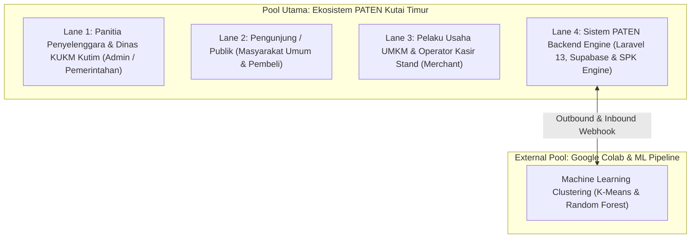

# Panduan Teknis & Arsitektur Proses Bisnis BPMN 2.0
## Proyek PATEN (Pemantauan Transaksi & Efektivitas Niaga) – Kabupaten Kutai Timur

Dokumen ini merupakan panduan resmi **System Analyst** dan **Business Process Engineer** untuk mengoperasikan, meninjau, dan mengembangkan model proses bisnis **BPMN 2.0 (Camunda 8 / Zeebe Engine)** pada platform **PATEN**.

---

## 1. Metadata Model & Status Cluster Camunda 8

| Atribut | Nilai Spesifikasi | Keterangan |
| :--- | :--- | :--- |
| **Process Definition ID** | `Process_PATEN_E2E` | ID unik proses yang dieksekusi Zeebe |
| **Process Name** | Sistem PATEN - Proses Bisnis End-to-End | Nama resmi proses pada Camunda Operate |
| **Process Definition Key** | `2251799813707398` | Kunci internal pada Zeebe Broker |
| **Deployment Key** | `2251799813707397` | Kunci batch deployment REST v2 |
| **Versi Proses** | `1` | Versi aktif |
| **Status di Engine** | `ACTIVE` | Terverifikasi via Camunda MCP & Zeebe |
| **Resource File** | `docs/bpmn/paten_business_process_e2e.bpmn` | File sumber BPMN 2.0 XML |
| **Execution Platform** | Camunda Cloud / Camunda 8 (Zeebe 8.10.x) | Kompatibel Camunda Desktop Modeler v5.x |

---

## 2. Arsitektur Kolaborasi: 4 Swimlanes & 1 External Pool

Model BPMN 2.0 dirancang menggunakan pendekatan **Unified Master Collaboration** dengan batas tanggung jawab (*separation of concerns*) yang tegas:



### 2.1. Tanggung Jawab Masing-Masing Lane

1. **Lane Panitia Penyelenggara & Dinas KUKM Kutim**:
   - Menginisiasi event dan memilih skema warna dinamis di `/events/create`.
   - Mengelola rundown dan *batch provisioning* kuota stand di dashboard privat `/cms/{slug}?token=...`.
   - Menjalankan scanner gerbang (*gate check-in*) pada `/cms/{slug}/check-in`.
   - Memicu pengundian doorprize acak khusus pengunjung yang terkonfirmasi hadir fisik.
   - Memicu evaluasi SPK SAW dan meninjau laporan rekomendasi kebijakan dinas di `/cms/{slug}/evaluations`.
2. **Lane Pengunjung / Publik**:
   - Membuka halaman publik acara `/e/{slug}`.
   - Melakukan registrasi mandiri tiket pengunjung (HTM / Kupon Doorprize).
   - Menerima e-tiket unik ber-QR Code SVG (`PATEN-DOOR` / `PATEN-HTM`).
   - Melakukan check-in fisik di gerbang masuk acara.
   - Berkunjung ke stand UMKM, memesan menu, dan bertransaksi (Tunai / QRIS).
   - Memantau pengundian doorprize dan leaderboard stan live.
3. **Lane Pelaku Usaha UMKM & Operator Kasir Stand**:
   - Melengkapi registrasi profil kepatuhan Perbup Kutim di `/stands/{stand_id}/assign` (NIK 16 digit, KK 16 digit, NIB, sertifikasi halal/P-IRT, riwayat bantuan modal APBD).
   - Mendaftarkan katalog menu awal stan dan harga jual.
   - Mengakses terminal kasir di `/pos/{stand_id}/login` menggunakan autentikasi PIN 6-digit.
   - Mengoperasikan POS Mini: memilih item, jumlah kuantitas, memilih pembayaran Tunai/QRIS, dan menyerahkan pesanan.
4. **Lane Sistem PATEN Backend Engine**:
   - **Otentikasi & Keamanan:** Pembentukan *64-character cryptographic token* tanpa password polos, serta perlindungan *rate limiting* anti-DDoS tiket (30 req/menit) dan anti-brute force PIN (10 req/menit).
   - **Integritas Tiket & Gate:** Validasi pencegahan tiket palsu dan duplikasi kehadiran fisik (HTTP 409 Conflict).
   - **POS Mini Atomik:** Eksekusi transaksi atomik dalam `DB::transaction()` dengan penguncian tingkat baris (*database row-level lock*) `lockForUpdate()` pada record `EventStand` guna mencegah *race condition* dan *lost updates*.
   - **SPK SAW Multi-Kriteria:** Normalisasi matriks keputusan untuk 5 kriteria objektif (Frekuensi 30%, Omzet 20%, Jam Aktif 25%, QRIS 10%, Legalitas 15%).
   - **Enforcement Deterministik Guardrail Perbup Kutim**:
     * *Guardrail 1 (Syarat NIB):* Tanpa NIB $\rightarrow$ diskualifikasi hibah APBD, dialihkan ke fasilitasi legalitas.
     * *Guardrail 2 (Anti-Duplikasi APBD):* Pernah menerima hibah APBD pada tahun sebelumnya $\rightarrow$ dialihkan ke kredit perbankan.
     * *Guardrail 3 (Prinsip 1 KK 1 Penerima):* Jika terdapat lebih dari 1 UMKM dalam KK yang sama dengan skor lolos hibah APBD, skor tertinggi berhak atas nominasi hibah APBD; anggota KK lainnya dialihkan ke kredit perbankan.
   - **Kepatuhan Privasi (UU PDP):** Penyensoran ketat NIK, KK, nomor kontak, serta masking nominal omzet rupiah pada leaderboard publik (`/e/{slug}/leaderboard`).

---

## 3. Kamus Service Task & Definisi Zeebe Worker

Seluruh *Service Task* dan *Business Rule Task* telah dikonfigurasi dengan tipe *Zeebe Task Definition* resmi:

| Nama Task di Diagram | ID Elemen BPMN | Zeebe Job Type | Variabel Input Kunci | Variabel Output Kunci |
| :--- | :--- | :--- | :--- | :--- |
| **Generate Event & Token** | `Task_GenerateEventToken` | `paten-event-generator` | `nama_event`, `slug`, `theme_color` | `event_id`, `secure_token` |
| **Batch Provisioning Stand** | `Task_ProvisionStandsBatch` | `paten-stand-provisioner` | `event_id`, `jumlah_stand` | `stands_count`, `pins_generated` |
| **Issue QR SVG Tiket** | `Task_IssueTiketQr` | `paten-ticket-issuer` | `nama_lengkap`, `no_wa`, `tipe_tiket` | `nomor_tiket`, `qr_svg` |
| **Verifikasi Gate Check-in** | `Task_KonfirmasiKehadiran` | `paten-gate-verifier` | `nomor_tiket_doorprize` | `is_checked_in`, `check_in_time` |
| **Filter & Undi Doorprize** | `Task_EksekusiUndianAcak` | `paten-doorprize-drawer` | `event_id`, `jumlah_pemenang` | `winners_list` |
| **Simpan Profil UMKM** | `Task_SimpanProfilUmkm` | `paten-umkm-profiler` | `nik`, `no_kk`, `nib`, `has_halal` | `umkm_id`, `stand_assigned` |
| **Transaksi Atomik POS Mini**| `Task_EksekusiTransaksiAtomik` | `paten-pos-processor` | `stand_id`, `menu_id`, `qty`, `metode` | `subtotal`, `omzet_total`, `tx_total` |
| **Kalkulasi SAW 5 Kriteria** | `Task_HitungNormalisasiSaw` | `paten-spk-calculator` | `event_id` | `raw_saw_scores` |
| **Guardrail Perbup Kutim** | `Task_GuardrailPerbupKutim` | `paten-perbup-guardrail` | `raw_saw_scores`, `no_kk` | `final_evaluations`, `rekomendasi` |
| **Sinkronisasi Webhook ML** | `Task_KirimWebhookColab` | `paten-ml-syncer` | `event_id`, `evaluations` | `synced_count`, `cluster_kategori` |
| **Sensor & Masking UU PDP** | `Task_MaskingDataPublik` | `paten-privacy-masker` | `evaluations` | `leaderboard_masked_data` |

---

## 4. Panduan Membuka & Mengedit di Camunda Modeler

Aplikasi desktop **Camunda Modeler** telah terpasang pada sistem Mac Anda di:
`/Applications/Camunda Modeler.app`.

### Cara Membuka Diagram:
Jalankan perintah berikut pada terminal:
```bash
open -a "Camunda Modeler" docs/bpmn/paten_business_process_e2e.bpmn
```
Atau buka **Camunda Modeler** $\rightarrow$ pilih **File** $\rightarrow$ **Open File...** $\rightarrow$ arahkan ke direktori proyek:
`PATEN/docs/bpmn/paten_business_process_e2e.bpmn`.

### Konfigurasi Target Camunda 8 di Modeler:
- **Execution Platform:** Camunda Cloud / Camunda 8
- **Platform Version:** 8.10.x
- **Cluster Endpoint (untuk Deploy langsung dari Modeler):**
  - Endpoint: `http://localhost:8080`
  - Authentication: `None`

---

## 5. Cara Deploy Ulang & Pemantauan via Camunda Operate

Jika Anda melakukan perubahan grafis atau logika pada file BPMN di masa depan:

1. **Deploy via cURL (REST API v2):**
   ```bash
   curl -X POST -F "resources=@docs/bpmn/paten_business_process_e2e.bpmn" http://localhost:8080/v2/deployments
   ```
2. **Pemantauan Real-Time di Camunda Operate:**
   - Akses antarmuka web di browser: `http://localhost:8080/operate`
   - Kredensial default:
     * **Username:** `demo`
     * **Password:** `demo`
   - Buka menu **Processes** $\rightarrow$ pilih **Sistem PATEN - Proses Bisnis End-to-End**. Anda dapat melihat visual diagram, jumlah instance aktif, token flow, dan status insiden secara grafis.

---

## 6. Verifikasi & Otomasi Melalui Camunda MCP

Karena server MCP `camunda` telah terhubung ke cluster Zeebe lokal, Anda dapat menjalankan perintah agentic untuk mengelola instance:

- **Mencari definisi proses:** Tool MCP `searchProcessDefinitions` dengan filter `{"processDefinitionId": "Process_PATEN_E2E"}`.
- **Mengambil struktur XML terbaru:** Tool MCP `getProcessDefinitionXml` dengan parameter `processDefinitionKey: 2251799813707398`.
- **Membuat instance alur baru:** Tool MCP `createProcessInstance` dengan parameter:
  ```json
  {
    "processDefinitionId": "Process_PATEN_E2E",
    "variables": {
      "nama_event": "Pesta Rakyat UMKM Sangatta 2026",
      "slug": "pesta-rakyat-sangatta-2026"
    }
  }
  ```
- **Memeriksa User Task panitia/kasir:** Tool MCP `searchUserTasks`.
- **Menyelesaikan User Task:** Tool MCP `completeUserTask`.
