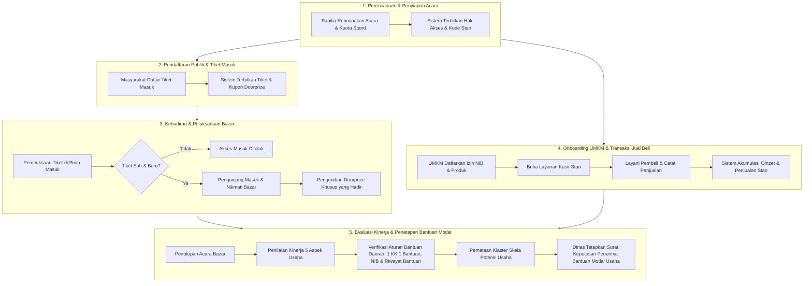

# Dokumentasi Alur Proses Bisnis (BPMN 2.0)
## Program PATEN: Penyelenggaraan Event Bazar, Transaksi UMKM & Seleksi Bantuan Modal Usaha
### Dinas Koperasi & UKM Kabupaten Kutai Timur

Dokumen ini merupakan panduan resmi **Proses Bisnis (Probis)** yang menggambarkan tata kelola penyelenggaraan pameran/bazar daerah, operasional stan UMKM, hingga penetapan penerima bantuan modal usaha daerah secara transparan, adil, dan objektif.

Model proses bisnis ini menggunakan standar internasional **BPMN 2.0** dan telah aktif di engine **Camunda 8**:
- **Nama Proses:** Alur Proses Bisnis Terpadu Penyelenggaraan Event dan Evaluasi Bantuan UMKM
- **ID Proses:** `Process_PATEN_E2E` (Versi 2 - Aktif)
- **File Model:** `docs/bpmn/paten_business_process_e2e.bpmn`

---

## 1. Para Pihak yang Terlibat (Aktor & Peran)

Proses bisnis ini membagi tanggung jawab ke dalam 4 peran utama:

1. **Panitia Penyelenggara & Dinas Koperasi UKM**:
   - Merencanakan jadwal dan kuota bazar/pameran daerah.
   - Menetapkan pembagian stan dan jadwal kegiatan acara.
   - Melakukan pemeriksaan tiket masuk di gerbang acara.
   - Melaksanakan pengundian doorprize bagi pengunjung yang hadir.
   - Meninjau hasil evaluasi dan menetapkan surat keputusan (SK) penerima bantuan modal usaha.
2. **Pengunjung / Masyarakat (Konsumen)**:
   - Mendaftar tiket masuk acara secara mandiri.
   - Menerima tiket masuk dan kupon undian doorprize.
   - Hadir di lokasi pameran dan menikmati acara bazar.
   - Berbelanja produk di stan UMKM peserta bazar.
3. **Pelaku Usaha UMKM & Kasir Stan**:
   - Mendaftarkan profil usaha, kelengkapan izin berusaha (NIB), sertifikasi halal/PIRT, dan riwayat bantuan terdahulu.
   - Mendaftarkan daftar produk jualan dan harga.
   - Membuka layanan kasir stan pameran.
   - Melayani transaksi pembelian dari pengunjung (Tunai maupun Non-Tunai).
4. **Sistem Informasi PATEN**:
   - Mengelola penerbitan hak akses pengelolaan acara dan kode stan.
   - Menerbitkan tiket masuk resmi dan nomor undian doorprize.
   - Memvalidasi keabsahan tiket di pintu masuk dan mencatat kehadiran pengunjung.
   - Mencatat setiap transaksi penjualan dan menghitung akumulasi omzet stan.
   - Menilai kinerja usaha stan berdasarkan data penjualan nyata di lapangan.
   - Memverifikasi syarat kepatuhan aturan bantuan modal daerah.
   - Mengelompokkan skala potensi usaha dan menyusun rekomendasi program bantuan.

---

## 2. Alur Proses Bisnis End-to-End (5 Tahapan Inti)



---

## 3. Rincian Pelaksanaan Setiap Tahapan

### Tahap 1: Perencanaan Acara & Penyiapan Stan Bazar
- Panitia Dinas menyusun parameter acara: nama kegiatan, tanggal pelaksanaan, dan kapasitas kuota stan peserta.
- Sistem menerbitkan nomor urut stan dan kode akses pelayanan stan bagi UMKM terpilih.

### Tahap 2: Pendaftaran Pengunjung & Tiket Digital
- Masyarakat umum mendaftar secara mandiri untuk mendapatkan tiket kunjungan acara.
- Sistem secara otomatis menerbitkan tiket digital resmi yang dilengkapi nomor undian doorprize.

### Tahap 3: Pemeriksaan di Pintu Gerbang & Pengundian Doorprize
- Pengunjung tiba di gerbang acara dan memperlihatkan tiket masuk kepada petugas.
- Petugas memeriksa keabsahan tiket:
  * Jika tiket sudah pernah digunakan atau tidak terdaftar, akses masuk ditolak.
  * Jika tiket sah dan baru, sistem mencatat status kehadiran fisik pengunjung.
- Pengunjung dapat masuk ke area bazar dan berbelanja.
- Pada sesi hiburan, panitia melakukan pengundian doorprize, di mana sistem secara otomatis **hanya mengundi pengunjung yang terbukti hadir fisik di lokasi**.

### Tahap 4: Pendaftaran Profil Usaha & Transaksi Penjualan Stan
- Pelaku usaha UMKM mendaftarkan data usahanya: kepemilikan izin NIB, sertifikat halal/PIRT, data Kartu Keluarga, dan riwayat penerimaan bantuan modal di masa lalu.
- Pelaku usaha mendaftarkan daftar menu dan harga produk yang dijual.
- Pelaku usaha membuka layanan kasir dan melayani transaksi pembelian pengunjung (baik tunai maupun non-tunai/QRIS).
- Setiap transaksi langsung dicatat oleh sistem untuk menjamin rekapan omzet dan frekuensi penjualan akurat serta dapat dipertanggungjawabkan.

### Tahap 5: Penilaian Kinerja Usaha & Penetapan Kebijakan Bantuan
Setelah acara bazar selesai, sistem melakukan evaluasi kelayakan bantuan modal usaha:
1. **Penilaian Kinerja Nyata (5 Kriteria):**
   - Tingkat keaktifan transaksi penjualan (30%)
   - Total omzet penjualan yang diraih selama acara (20%)
   - Konsistensi jam buka layanan stan (25%)
   - Tingkat adopsi pembayaran digital (10%)
   - Kelengkapan izin usaha resmi / NIB & sertifikasi (15%)
2. **Penerapan Aturan Kebijakan Daerah (Perbup Kutim):**
   - **Prinsip 1 KK 1 Bantuan Modal:** Satu Kartu Keluarga hanya berhak menerima maksimal 1 kuota bantuan hibah modal APBD. Jika dalam satu keluarga terdapat lebih dari 1 pelaku usaha yang berprestasi, peserta dengan nilai tertinggi berhak atas bantuan hibah modal, sedangkan anggota keluarga lainnya diarahkan ke program fasilitasi kredit perbankan.
   - **Kewajiban Izin NIB:** Pelaku usaha wajib memiliki NIB untuk dapat diprioritaskan menerima hibah modal APBD. Pelaku usaha yang belum memiliki NIB diarahkan ke program pendampingan dan fasilitasi legalitas gratis.
   - **Pemerataan Bantuan (Bebas Duplikasi):** Pelaku usaha yang pernah menerima bantuan hibah modal APBD pada tahun sebelumnya dialihkan ke program pendampingan kredit perbankan agar penerima bantuan baru dapat bergantian menikmati APBD.
3. **Penetapan Rekomendasi Program:**
   - Dinas Koperasi & UKM menelaah laporan rekomendasi sistem dan menerbitkan **Surat Keputusan (SK) Penerima Bantuan Modal Usaha & Program Pembinaan Daerah**.

---

## 4. Cara Meninjau Model di Camunda Desktop Modeler

Model proses bisnis ini dapat dibuka langsung di aplikasi desktop **Camunda Modeler** pada Mac Anda:
```bash
open -a "Camunda Modeler" docs/bpmn/paten_business_process_e2e.bpmn
```
Atau pantau diagram visual interaktif dan alur instansinya pada antarmuka web **Camunda Operate**:
- Alamat: `http://localhost:8080/operate`
- Login: Username `demo`, Password `demo`
- Buka menu **Processes** $\rightarrow$ pilih **Alur Proses Bisnis Terpadu Penyelenggaraan Event dan Evaluasi Bantuan UMKM**.
