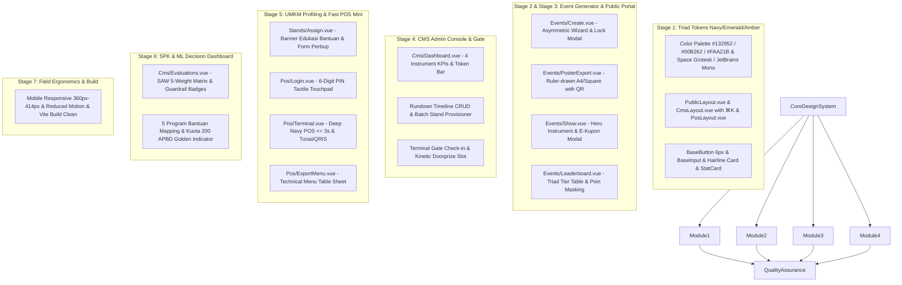

# Master Frontend Staging Plan: Sistem PATEN Kutai Timur
## Pemantauan Transaksi & Efektivitas Niaga — Triad Color System Architecture

**Standar Desain & Metodologi:**  
- **Design Skill:** [Hallmark Anti-AI-Slop Consensus](file:///c:/Users/Crush/Downloads/PATEN/.agents/skills/hallmark/SKILL.md)  
- **Selected Color Triad:**
  1. **Deep Navy Blue:** `#132952` / `rgb(19, 41, 82)` — Primary Anchor, Ink, Headers, Primary Buttons & Focus Ring
  2. **Vibrant Emerald Green:** `#00B262` / `rgb(0, 178, 98)` — Success, Verified Badges, QR/POS Online Signals, Cash Flow
  3. **Warm Amber Orange:** `#FAA21B` / `rgb(250, 162, 27)` — Gamifikasi, Doorprize, Warning, Kupon Callouts
- **Dokumen Referensi Produk:** [PRD PATEN Kutim](file:///c:/Users/Crush/Downloads/PATEN/docs/references/product_requirements_document_prd_paten_kutim.md) | [BRD PATEN Kutim](file:///c:/Users/Crush/Downloads/PATEN/docs/references/business_requirements_document_brd_paten_kutim.md)  
- **Status Backend:** [100% PASS (44 Automated Tests)](file:///c:/Users/Crush/Downloads/PATEN/docs/CONSOLIDATED_TESTING_REPORT.md)  

---

## 1. Filosofi Desain: The Triad Institutional Register

Sistem **PATEN (Pemantauan Transaksi & Efektivitas Niaga)** Kabupaten Kutai Timur bukan sekadar aplikasi web biasa, melainkan **infrastruktur digital niaga & instrumen verifikasi bantuan publik**. Mengadopsi prinsip **Hallmark Anti-AI-Slop** dengan palet tiga warna berwibawa: **Deep Navy Blue**, **Vibrant Emerald Green**, dan **Warm Amber Orange**, antarmuka PATEN dirancang dengan register *modern-minimal dev-tool & instrument panel* (presisi, berwibawa, dan fungsional):

```text
[ ANTI-AI-SLOP DISCIPLINE — TRIAD COLOR SYSTEM ]
1. STRICT COLOR TRIAD         --> Deep Navy Blue (#132952) + Vibrant Emerald Green (#00B262) + Warm Amber Orange (#FAA21B).
2. NO PURPLE/PINK GRADIENTS   --> Cool engineered paper (#F8FAFC) + Solid hairline borders.
3. NO GENERIC INTER-ONLY      --> Space Grotesk (Display) + Inter (Body) + JetBrains Mono (Labels/Kbd/Code).
4. NO CENTRED-EVERYTHING      --> Left-biased asymmetric structure (Title-left, Interactive-demo right).
5. NO ICON-TILE TEMPLATES     --> Hairline-bordered instrument cards (1px ruler-drawn borders).
6. NO FLOATING PILL CTAS      --> Tight 6px technical radius buttons, distinct Navy/Emerald/Amber roles.
7. NO GLASSOVERLAY BLUR-SOUP  --> Depth comes from sharp 1px borders & deep navy contrast, not heavy blur.
```

---

## 2. Arsitektur Token & Palet Warna Eksklusif (Triad System)

Sistem styling antarmuka PATEN beroperasi secara disiplin dengan tiga warna inti:

| Peran Token | Variabel CSS / Hex | Nilai RGB | Penerapan Antarmuka |
| :--- | :--- | :--- | :--- |
| **Deep Navy Blue** | `--color-navy` / `#132952` | `rgb(19, 41, 82)` | **Primary Anchor:** Navbar header, judul display, tombol primer, kartu dark instrumen, focus ring, border aktif. |
| **Vibrant Emerald Green** | `--color-emerald` / `#00B262` | `rgb(0, 178, 98)` | **Growth & Verified Signal:** Status transaksi berhasil, lencana lolos Perbup, indikator online POS, kupon terpakai, sinyal 200 OK. |
| **Warm Amber Orange** | `--color-amber` / `#FAA21B` | `rgb(250, 162, 27)` | **Gamification & Warning:** Lencana undian doorprize, kuota terbatas, peringatan Perbup, ranking podium #1 emas, aksen callout. |
| **Paper Ground** | `#F8FAFC` | `rgb(248, 250, 252)` | Latar utama aplikasi (tidak pernah `#FFFFFF` murni menyilaukan). |
| **Hairline Rule**| `#E2E8F0` / `#CBD5E1` | `rgb(226, 232, 240)` | Pembatas seksi, batas sel tabel, garis navbar atas, ruler-drawn divider. |
| **Ink Body** | `#1E293B` / `#334155` | `rgb(30, 41, 59)` | Teks isi dokumen, paragraf deskripsi, dan formulir input. |

### Font Stack Wajib:
```html
<link rel="preconnect" href="https://fonts.googleapis.com">
<link rel="preconnect" href="https://fonts.gstatic.com" crossorigin>
<link href="https://fonts.googleapis.com/css2?family=Space+Grotesk:wght@500;600;700&family=Inter:wght@400;500;600&family=JetBrains+Mono:wght@400;500;600&display=swap" rel="stylesheet">
```
- **Display (`font-display`):** `Space Grotesk` (500/600/700) — tegas, berkarakter mekanikal modern, tracking sedikit rapat (`-0.02em`).
- **Body (`font-sans`):** `Inter` (400/500) — keterbacaan tinggi untuk formulir regulasi Perbup.
- **Code & Labels (`font-mono`):** `JetBrains Mono` (500/600) — UPPERCASE dengan tracking `0.06em` untuk nomor stand, PIN kasir, kode tiket `PATEN-DOOR`, metrik SAW, dan hint shortcut `⌘K`.

---

## 3. Fitur Khas Desain Triad pada Proyek PATEN

1. **Working ⌘K Command Palette (`GlobalCommandPalette.vue`):**
   - Affordance khas di pojok kanan navbar: tombol border ramping `⌘K` / `Ctrl+K`.
   - Mengaktifkan modal dialog pencarian cepat: navigasi ke CMS, ganti tab evaluasi, cari stan UMKM, buka terminal kasir, atau jalankan evaluasi SPK langsung via keyboard.
2. **Asymmetric Rhythm (Left-Aligned Display, Right-Aligned Instrument/Demo):**
   - Halaman pembuatan event dan microsite publik tidak lagi menaruh segala teks di tengah. Judul dan lede berada di sisi kiri; kartu instrumen (preview tema / tiket live) berada di sisi kanan.
3. **Tight Technical Radii (Ruler-Drawn Geometry):**
   - Radius kontrol (tombol, input, dropdown): `6px` (`rounded-[6px]`).
   - Radius kartu dan terminal: `10px` (`rounded-[10px]`).
   - Tidak ada tombol pil bulat menggelembung (*no pill shapes*).
4. **Navy Dark Band Rhythm:**
   - Halaman kasir POS Mini (`/pos/{id}`) dan dashboard evaluasi SPK memiliki band instrumen gelap Deep Navy (`#132952`) bergaris rambut tipis, memberikan ritme terang $\to$ gelap yang tegas.
5. **Micro-Motion:**
   - Transisi fade + rise 10px berbasis `cubic-bezier(0.16, 1, 0.3, 1)` ~600ms dengan dukungan penuh `prefers-reduced-motion: reduce`.
   - Garis hover navy/emerald underline yang tumbuh lembut, pergeseran border 1px ke navy/emerald saat fokus/hover.

---

## 4. Peta Rute & Halaman Frontend Berbasis Triad Color System



---

## 5. Roadmap Staging Frontend Terpadu (Triad Edition)

| Stage | Dokumen Rencana | Komponen & Halaman Target | Fokus Triad Color System |
| :---: | :--- | :--- | :--- |
| **1** | [**`frontend_stage_1_plan.md`**](file:///c:/Users/Crush/Downloads/PATEN/docs/staging/frontend_stage_1_plan.md) | `css/app.css`, `Layouts/*`, `Components/UI/*`, `GlobalCommandPalette.vue` | Injeksi token Deep Navy `#132952`, Emerald `#00B262`, Amber `#FAA21B`, font Space Grotesk/Inter/JetBrains Mono, palet ⌘K, tombol radius 6px, kartu hairline 1px. |
| **2** | [**`frontend_stage_2_plan.md`**](file:///c:/Users/Crush/Downloads/PATEN/docs/staging/frontend_stage_2_plan.md) | `Pages/Events/Create.vue`, `Pages/Events/PosterExport.vue` | Asymmetric form layout, pop-quiz theme selector dengan kartu pratinjau mini, lock confirmation dialog, poster cetak presisi A4. |
| **3** | [**`frontend_stage_3_plan.md`**](file:///c:/Users/Crush/Downloads/PATEN/docs/staging/frontend_stage_3_plan.md) | `Pages/Events/Show.vue`, `Pages/Events/Leaderboard.vue` | Hero instrument (title-left, live-status right), rundown timeline, E-kupon gerigi ber-QR, podium klasemen dengan masking omzet. |
| **4** | [**`frontend_stage_4_plan.md`**](file:///c:/Users/Crush/Downloads/PATEN/docs/staging/frontend_stage_4_plan.md) | `Pages/Cms/Dashboard.vue`, `GateCheckin`, `DoorprizeMachine` | Header token 64-karakter dengan 1-klik salin, 4 kartu KPI instrumen, batch slot stand, scanner tiket gate, animasi slot doorprize. |
| **5** | [**`frontend_stage_5_plan.md`**](file:///c:/Users/Crush/Downloads/PATEN/docs/staging/frontend_stage_5_plan.md) | `Pages/Stands/Assign.vue`, `Pages/Pos/Login.vue`, `Pages/Pos/Terminal.vue` | Banner edukasi resmi Diskop-UKM (bukan pajak), keypad sentuh PIN 6 digit, terminal kasir graphite card $\le 3$ detik, cetak menu meja. |
| **6** | [**`frontend_stage_6_plan.md`**](file:///c:/Users/Crush/Downloads/PATEN/docs/staging/frontend_stage_6_plan.md) | `Pages/Cms/Evaluations.vue`, `SawScoreBreakdown`, `GuardrailBadge` | Matriks skor SAW 5 bobot, lencana verifikasi 1 KK 1 Penerima & NIB, pemetaan 5 program bantuan daerah (highlight kuota 200 APBD). |
| **7** | [**`frontend_stage_7_plan.md`**](file:///c:/Users/Crush/Downloads/PATEN/docs/staging/frontend_stage_7_plan.md) | Integrasi End-to-End, Ergonomi Layar Sentuh Lapangan (360px), Vite Build | Verifikasi responsif ponsel bazar terbuka, pencegahan double-submit, WCAG AA, dan `npm run build` sukses 100%. |

---

## 6. Kriteria Penerimaan (Definition of Done)
1. **Triad Visual Identity:** Seluruh halaman menerapkan kanvas sejuk `#F8FAFC`, hairline border 1px `#E2E8F0`/`#CBD5E1`, dan disiplin palet Triad: Deep Navy Blue `#132952`, Vibrant Emerald Green `#00B262`, dan Warm Amber Orange `#FAA21B` tanpa gradien ungu-pink atau teks gradien.
2. **Typographic Integrity:** Judul menggunakan `Space Grotesk`, teks bacaan `Inter`, dan label teknis/kode/PIN `JetBrains Mono` dalam gaya huruf kapital (*uppercase tracking*).
3. **Interactive ⌘K Affordance:** Fitur pencarian cepat dan navigasi keyboard berfungsi responsif di desktop/tablet.
4. **Zero-Friction Ergonomics:** Transaksi POS Mini kasir selesai dalam waktu $\le 3$ detik dengan umpan balik visual instan.
5. **No Slop Violations:** Lolos 100% dari 5 larangan anti-pattern Hallmark.
6. **Vite Compilation:** Menghasilkan build manifes produksi bersih (`npm run build`) tanpa error.
