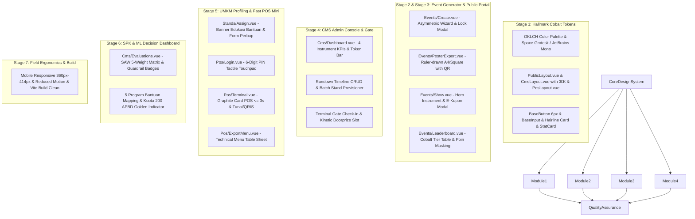

# Master Frontend Staging Plan: Sistem PATEN Kutai Timur
## Pemantauan Transaksi & Efektivitas Niaga — Hallmark Cobalt Theme Architecture

**Standar Desain & Metodologi:**  
- **Design Skill:** [Hallmark Anti-AI-Slop Consensus](file:///c:/Users/Crush/Downloads/PATEN/.agents/skills/hallmark/SKILL.md)  
- **Selected Archetype & Theme:** **Cobalt** ([`themes/cobalt.md`](file:///c:/Users/Crush/Downloads/PATEN/.agents/skills/hallmark/references/themes/cobalt.md))  
- **Dokumen Referensi Produk:** [PRD PATEN Kutim](file:///c:/Users/Crush/Downloads/PATEN/docs/references/product_requirements_document_prd_paten_kutim.md) | [BRD PATEN Kutim](file:///c:/Users/Crush/Downloads/PATEN/docs/references/business_requirements_document_brd_paten_kutim.md)  
- **Status Backend:** [100% PASS (44 Automated Tests)](file:///c:/Users/Crush/Downloads/PATEN/docs/CONSOLIDATED_TESTING_REPORT.md)  

---

## 1. Filosofi Desain: The Hallmark Cobalt Register

Sistem **PATEN (Pemantauan Transaksi & Efektivitas Niaga)** Kabupaten Kutai Timur bukan sekadar aplikasi web biasa, melainkan **infrastruktur digital niaga & instrumen verifikasi bantuan publik**. Mengadopsi prinsip **Hallmark Anti-AI-Slop** dengan tema **Cobalt**, antarmuka PATEN dirancang dengan register *modern-minimal dev-tool & instrument panel* (terinspirasi oleh presisi GitBook, Stripe Docs, Linear, Vercel, dan Supabase):

```text
[ ANTI-AI-SLOP DISCIPLINE — COBALT THEME ]
1. NO PURPLE/PINK GRADIENTS   --> Cool engineered paper (oklch 98.5% 0.004 250) + Solid surfaces.
2. NO GENERIC INTER-ONLY      --> Space Grotesk (Display) + Inter (Body) + JetBrains Mono (Labels/Kbd/Code).
3. NO CENTRED-EVERYTHING      --> Left-biased asymmetric structure (Title-left, Interactive-demo right).
4. NO ICON-TILE TEMPLATES     --> Hairline-bordered instrument cards (1px ruler-drawn borders).
5. NO FLOATING PILL CTAS      --> Tight 6px technical radius buttons, single Electric Cobalt signal accent.
6. NO GLASSOVERLAY BLUR-SOUP  --> Depth comes from sharp 1px borders & graphite contrast, not heavy blur.
7. SIGNAL ACCENT RESTRICTION  --> Electric Cobalt (oklch 58% 0.20 256) strictly < 5% of viewport.
```

---

## 2. Arsitektur Token & Palet Warna Cobalt (OKLCH Foundation)

Cobalt menggunakan kanvas sejuk terkayakan garis rambut (*hairlines*) dengan satu aksen sinyal biru elektrik yang tajam:

| Peran Token | Variabel CSS / OKLCH | Nilai Hex Padanan | Penerapan Antarmuka |
| :--- | :--- | :--- | :--- |
| **Paper Ground** | `oklch(98.5% 0.004 250)` | `#F8FAFC` (Cool Off-white) | Latar utama aplikasi (tidak pernah `#FFFFFF` murni). |
| **Ink Primary** | `oklch(24% 0.02 258)` | `#1E293B` (Cool Charcoal) | Judul utama, angka metrik, dan teks kontras tinggi. |
| **Ink Secondary**| `oklch(34% 0.018 257)` | `#334155` (Slate Body) | Paragraf penjelas, deskripsi, dan label sekunder. |
| **Muted Ink** | `oklch(55% 0.015 255)` | `#64748B` (Cool Muted) | Timestamp, placeholder, dan metadata teks. |
| **Signal Accent** | `oklch(58% 0.20 256)` | `#2563EB` / `#1D4ED8` (Electric Cobalt)| **Sinyal tunggal (< 5%):** Tombol aksi utama, lencana aktif, focus ring, indikator 200 OK, dan underline tumbuh. |
| **Hairline Rule**| `oklch(90% 0.01 250)` | `#E2E8F0` (1px Precision Line)| Pembatas seksi, batas sel tabel, garis navbar atas. |
| **Graphite Card**| `oklch(22% 0.016 260)` | `#0F172A` (Dark Graphite) | Kartu terminal POS Mini kasir, pratinjau payload SPK, dan band monokromatis gelap. |
| **Success Chip** | `oklch(62% 0.17 145)` | `#10B981` (Emerald Line) | Status tiket valid, transaksi berhasil, lolos Perbup. |
| **Caution Chip** | `oklch(60% 0.21 28)` | `#EF4444` (Ruby Line) | Diskualifikasi Perbup, PIN salah, duplikasi KK. |

### Font Stack Wajib:
```html
<link rel="preconnect" href="https://fonts.googleapis.com">
<link rel="preconnect" href="https://fonts.gstatic.com" crossorigin>
<link href="https://fonts.googleapis.com/css2?family=Space+Grotesk:wght@500;600;700&family=Inter:wght@400;500;600&family=JetBrains+Mono:wght@400;500;600&display=swap" rel="stylesheet">
```
- **Display (`font-display`):** `Space Grotesk` (500/600/700) — tegas, berkarakter mekanikal modern, tracking sedikit rapat (`-0.02em`).
- **Body (`font-sans`):** `Inter` (400/500) — keterbacaan tinggi untuk formulir regulasi Perbup.
- **Code & Labels (`font-mono`):** `JetBrains Mono` (500/600) — UPPERCASE dengan tracking `0.06em` untuk nomor stand, PIN kasir, kode tiket `PATEN-DOOR`, metrik SAW, dan hint shortcut `⌘K`.

---

## 3. Fitur Khas Hallmark Cobalt pada Proyek PATEN

1. **Working ⌘K Command Palette (`GlobalCommandPalette.vue`):**
   - Affordance khas Cobalt di pojok kanan navbar: tombol border ramping `⌘K` / `Ctrl+K`.
   - Mengaktifkan modal dialog pencarian cepat: navigasi ke CMS, ganti tab evaluasi, cari stan UMKM, buka terminal kasir, atau jalankan evaluasi SPK langsung via keyboard.
2. **Asymmetric Rhythm (Left-Aligned Display, Right-Aligned Instrument/Demo):**
   - Halaman pembuatan event dan microsite publik tidak lagi menaruh segala teks di tengah. Judul dan lede berada di sisi kiri; kartu instrumen (preview tema / tiket live) berada di sisi kanan.
3. **Tight Technical Radii (Ruler-Drawn Geometry):**
   - Radius kontrol (tombol, input, dropdown): `6px` (`rounded-[6px]`).
   - Radius kartu dan terminal: `10px` (`rounded-[10px]`).
   - Tidak ada tombol pil bulat menggelembung (*no pill shapes*).
4. **Graphite Dark Band Rhythm:**
   - Halaman kasir POS Mini (`/pos/{id}`) dan dashboard evaluasi SPK memiliki satu band instrumen gelap grafit (`oklch(22% 0.016 260)`) bergaris rambut tipis, memberikan ritme terang $\to$ gelap yang tegas.
5. **Micro-Motion:**
   - Transisi fade + rise 10px berbasis `cubic-bezier(0.16, 1, 0.3, 1)` ~600ms dengan dukungan penuh `prefers-reduced-motion: reduce`.
   - Garis hover cobalt underline yang tumbuh lembut, pergeseran border 1px ke cobalt saat fokus/hover.

---

## 4. Peta Rute & Halaman Frontend Berbasis Cobalt



---

## 5. Roadmap Staging Frontend Terpadu (Cobalt Edition)

| Stage | Dokumen Rencana | Komponen & Halaman Target | Fokus Hallmark Cobalt |
| :---: | :--- | :--- | :--- |
| **1** | [**`frontend_stage_1_plan.md`**](file:///c:/Users/Crush/Downloads/PATEN/docs/staging/frontend_stage_1_plan.md) | `css/app.css`, `Layouts/*`, `Components/UI/*`, `GlobalCommandPalette.vue` | Injeksi token OKLCH, font Space Grotesk/Inter/JetBrains Mono, palet ⌘K, tombol radius 6px, kartu hairline 1px. |
| **2** | [**`frontend_stage_2_plan.md`**](file:///c:/Users/Crush/Downloads/PATEN/docs/staging/frontend_stage_2_plan.md) | `Pages/Events/Create.vue`, `Pages/Events/PosterExport.vue` | Asymmetric form layout, pop-quiz theme selector dengan kartu pratinjau mini, lock confirmation dialog, poster cetak presisi A4. |
| **3** | [**`frontend_stage_3_plan.md`**](file:///c:/Users/Crush/Downloads/PATEN/docs/staging/frontend_stage_3_plan.md) | `Pages/Events/Show.vue`, `Pages/Events/Leaderboard.vue` | Hero instrument (title-left, live-status right), rundown timeline, E-kupon gerigi ber-QR, podium klasemen dengan masking omzet. |
| **4** | [**`frontend_stage_4_plan.md`**](file:///c:/Users/Crush/Downloads/PATEN/docs/staging/frontend_stage_4_plan.md) | `Pages/Cms/Dashboard.vue`, `GateCheckin`, `DoorprizeMachine` | Header token 64-karakter dengan 1-klik salin, 4 kartu KPI instrumen, batch slot stand, scanner tiket gate, animasi slot doorprize. |
| **5** | [**`frontend_stage_5_plan.md`**](file:///c:/Users/Crush/Downloads/PATEN/docs/staging/frontend_stage_5_plan.md) | `Pages/Stands/Assign.vue`, `Pages/Pos/Login.vue`, `Pages/Pos/Terminal.vue` | Banner edukasi resmi Diskop-UKM (bukan pajak), keypad sentuh PIN 6 digit, terminal kasir graphite card $\le 3$ detik, cetak menu meja. |
| **6** | [**`frontend_stage_6_plan.md`**](file:///c:/Users/Crush/Downloads/PATEN/docs/staging/frontend_stage_6_plan.md) | `Pages/Cms/Evaluations.vue`, `SawScoreBreakdown`, `GuardrailBadge` | Matriks skor SAW 5 bobot, lencana verifikasi 1 KK 1 Penerima & NIB, pemetaan 5 program bantuan daerah (highlight kuota 200 APBD). |
| **7** | [**`frontend_stage_7_plan.md`**](file:///c:/Users/Crush/Downloads/PATEN/docs/staging/frontend_stage_7_plan.md) | Integrasi End-to-End, Ergonomi Layar Sentuh Lapangan (360px), Vite Build | Verifikasi responsif ponsel bazar terbuka, pencegahan double-submit, WCAG AA, dan `npm run build` sukses 100%. |

---

## 6. Kriteria Penerimaan (Definition of Done)
1. **Cobalt Visual Identity:** Seluruh halaman menerapkan kanvas sejuk `oklch(98.5% 0.004 250)`, hairline border 1px `oklch(90% 0.01 250)`, dan aksen Electric Cobalt `oklch(58% 0.20 256)` secara disiplin tanpa gradien ungu-pink atau teks gradien.
2. **Typographic Integrity:** Judul menggunakan `Space Grotesk`, teks bacaan `Inter`, dan label teknis/kode/PIN `JetBrains Mono` dalam gaya huruf kapital (*uppercase tracking*).
3. **Interactive ⌘K Affordance:** Fitur pencarian cepat dan navigasi keyboard berfungsi responsif di desktop/tablet.
4. **Zero-Friction Ergonomics:** Transaksi POS Mini kasir selesai dalam waktu $\le 3$ detik dengan umpan balik visual instan.
5. **No Slop Violations:** Lolos 100% dari 5 larangan anti-pattern Hallmark.
6. **Vite Compilation:** Menghasilkan build manifes produksi bersih (`npm run build`) tanpa error.
