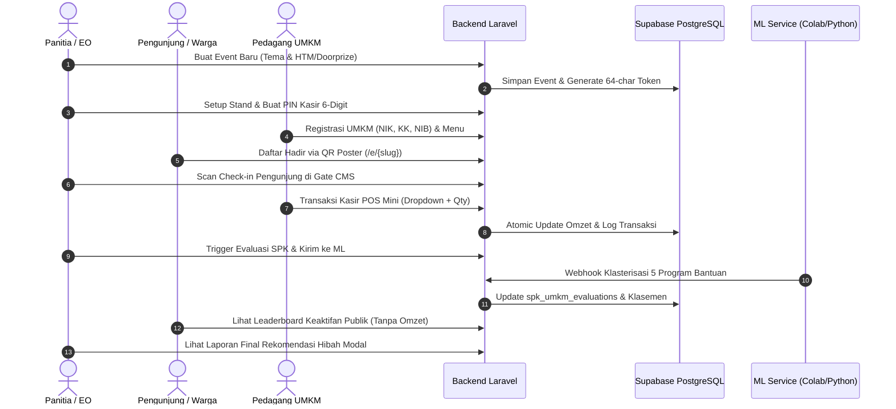

# Technical Staging Plan: STAGE 6
**Nama Tahapan:** End-to-End Integration, Atomic Concurrency Testing, Data Leak Audit & Final Verification  
**Target Modul:** Validasi Komprehensif Seluruh Alur Bisnis, Pengujian Konkurensi POS, Audit Privasi/Keamanan, dan Laporan Testing Terpusat  
**Standar Pengujian:** 100% PASS pada Automated Tests (Feature, Unit, Security, Stress)  

---

## 1. Lingkup Integrasi Sistem Menyeluruh (End-to-End Lifecycle)

Stage 6 menguji orkestrasi penuh seluruh modul yang telah dibangun dari Stage 1 hingga Stage 5 dalam satu skenario terpadu:



---

## 2. Pengujian Konkurensi & Transaksi Atomik (Atomic Concurrency Test)

### A. Skenario Uji Beban POS Mini
- **Tujuan:** Memastikan tidak terjadi *lost update* atau *race condition* ketika beberapa kasir menginput transaksi secara simultan pada stand yang sama atau stand yang berbeda.
- **Metode Pengujian:**
  - Menjalankan 50 transaksi secara paralel menggunakan thread/loop asinkron.
  - Memverifikasi hasil akhir di database:
    $$\text{total\_omzet\_terekam} = \sum_{i=1}^{50} \text{subtotal}_i$$
    $$\text{total\_transaksi\_terekam} = 50$$
  - Selisih rupiah wajib $\text{Rp } 0.00$ (toleransi nol).

---

## 3. Audit Keamanan & Pencegahan Kebocoran Data (Data Leak Security Audit)

### A. Matriks Audit Privasi
| Data Sensitif | Endpoint Publik (`/e/{slug}`, `/e/{slug}/leaderboard`) | Endpoint Kasir POS (`/pos/{stand_id}`) | Endpoint CMS Pengelola (`/cms/{slug}`) |
| :--- | :--- | :--- | :--- |
| **NIK (16 Digit)** | **DIBLOKIR MUTLAK** (Tidak boleh ada di JSON/HTML) | Disembunyikan | Ditampilkan untuk verifikasi DUKCAPIL |
| **Nomor KK (16 Digit)** | **DIBLOKIR MUTLAK** | Disembunyikan | Ditampilkan untuk verifikasi 1 KK |
| **Nomor HP / WhatsApp** | **DIBLOKIR MUTLAK** | Disembunyikan | Ditampilkan untuk koordinasi dinas |
| **Nominal Omzet (Rp)** | **DIBLOKIR MUTLAK** (Hanya poin/peringkat) | Ditampilkan (Total stand sendiri) | Ditampilkan (Akumulasi riil event) |
| **`secure_management_token`**| **DIBLOKIR MUTLAK** | Disembunyikan | Wajib sebagai parameter otorisasi |

---

## 4. Pelaporan Pengujian Terpusat (`docs/CONSOLIDATED_TESTING_REPORT.md`)

Pada akhir Stage 6, seluruh riwayat pengujian dari Stage 1 sampai Stage 6 dihimpun secara kumulatif ke dalam:
```text
docs/CONSOLIDATED_TESTING_REPORT.md
```

Format laporan mencakup:
1. Ringkasan Eksekutif Hasil Pengujian (Total Test Cases, Total Assertions, Passing Rate 100%).
2. Detail log pengujian per stage (Stage 1 s/d Stage 6).
3. Bukti integritas transaksi atomik dan audit keamanan bebas kebocoran data.

---

## 5. Skenario Pengujian Otomatis (Wajib 100% PASS)

File pengujian: `tests/Feature/Stage6EndToEndAndSecurityAuditTest.php`
1. `test_end_to_end_full_event_lifecycle_simulation`: Menjalankan siklus dari pembuatan event, pendaftaran stand, registrasi pengunjung, transaksi POS, undian doorprize, hingga kalkulasi evaluasi SPK.
2. `test_concurrent_pos_transactions_atomic_integrity`: Simulasi 50 transaksi bertubi-tubi tanpa ada data omzet yang hilang.
3. `test_comprehensive_security_audit_zero_data_leaks`: Inspeksi seluruh response body rute publik untuk memastikan tidak ada eksposur string NIK, KK, token, atau nominal rupiah.
4. `test_brute_force_pos_pin_rate_limiting`: Mencegah tebakan PIN kasir lebih dari 10 kali per menit dengan respons HTTP 429.
5. `test_cms_token_tampering_immunity`: Memastikan token acak atau manipulasi query string tidak dapat menembus dashboard panitia.
