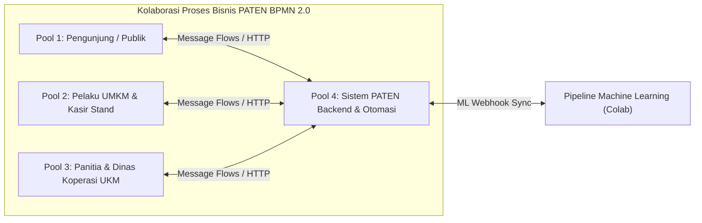
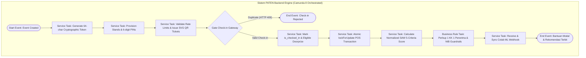

# Spesifikasi Desain Arsitektur Proses Bisnis BPMN 2.0 (End-to-End)
## Proyek PATEN (Pemantauan Transaksi & Efektivitas Niaga) – Kabupaten Kutai Timur

- **Dokumen ID:** SPEC-BPMN-PATEN-2026-001
- **Versi:** 1.0.0
- **Tanggal:** 18 Oktober 2026
- **Peran:** Senior System Analyst & Business Process Architect
- **Standar Notasi:** OMG BPMN 2.0 (ISO/IEC 19510:2013)
- **Target Platform:** Camunda 8 (Zeebe Orchestration Engine 8.10.x), Camunda Desktop Modeler v5.x
- **Target File Model:** `docs/bpmn/paten_business_process_e2e.bpmn`

---

## 1. Ringkasan Eksekutif & Tujuan Bisnis

Platform **PATEN (Pemantauan Transaksi & Efektivitas Niaga)** dibangun untuk memodernisasi ekosistem event, pameran daerah, dan bazar UMKM di Kabupaten Kutai Timur. Sistem ini menjembatani operasional lapangan secara *real-time* (registrasi publik, gate scanner, tiket ber-QR SVG, dan transaksi kasir stan POS mini) dengan proses evaluasi kebijakan bantuan modal usaha berbasis data akurat pada Dinas Koperasi & UKM Kabupaten Kutai Timur.

Tujuan utama pemodelan BPMN 2.0 ini adalah:
1. **Standardisasi Alur Bisnis Menyeluruh (*End-to-End*):** Menggambarkan interaksi lintas entitas secara transparan mulai dari perancangan event, tiket pengunjung, operasional kasir stan, hingga penentuan penerima bantuan modal.
2. **Penegakan Regulasi Perbup Kutai Timur secara Deterministik:** Mengotomasi verifikasi prinsip **1 KK 1 Penerima Bantuan Hibah APBD**, verifikasi kepemilikan Nomor Induk Berusaha (NIB), penapisan duplikasi riwayat penerima hibah masa lalu, serta afirmasi pelaku usaha disabilitas.
3. **Jaminan Integritas & Keamanan Transaksi:** Mengadopsi transaksi basis data atomik dengan penguncian baris (*row-level locking* `lockForUpdate()`), isolasi PIN stan 6-digit, serta perlindungan privasi data pribadi (UU PDP) dengan masking NIK, KK, dan omzet rupiah di endpoint publik.
4. **Kesiapan Eksekusi Otomasi (*Execution Ready*):** Model kompatibel penuh dengan Camunda 8 (Zeebe job workers, FEEL expressions, task types: `serviceTask`, `userTask`, `businessRuleTask`) serta visual diagram interchange (`bpmndi`) untuk dibuka di Camunda Desktop Modeler.

---

## 2. Arsitektur Kolaborasi, Pools & Swimlanes

Diagram dirancang sebagai **Unified Master Collaboration** yang memetakan 4 partisipan (Pools) utama:



### 2.1. Rincian Peran Partisipan

| Partisipan (Pool) | ID Pool BPMN | Tipe Interaksi | Peran & Tanggung Jawab Utama |
| :--- | :--- | :--- | :--- |
| **Pengunjung / Publik** | `Participant_Publik` | Human User (`userTask` / message) | Mengakses microsite acara publik, registrasi tiket mandiri, menerima e-tiket QR SVG, verifikasi kehadiran di gate, berbelanja di stan UMKM, memantau pengundian doorprize dan leaderboard. |
| **Pelaku UMKM & Kasir Stand** | `Participant_UMKM_Kasir` | Human User (`userTask`) | Menerima penugasan stan & PIN kasir, melengkapi profil kepatuhan Perbup Kutim (NIK, No KK, NIB, status halal, P-IRT, riwayat hibah), mendaftarkan menu awal, login kasir POS, dan mencatat transaksi pelanggan. |
| **Panitia & Dinas Koperasi UKM** | `Participant_Panitia_Dinas` | Government / Committee Admin | Membuat event & skema visual warna, mengakses dashboard CMS via URL rahasia bertoken kriptografi 64-karakter, mengelola rundown, batch provisioning stand & PIN, memindai tiket gate, mengundi doorprize, dan memvalidasi keputusan rekomendasi bantuan SPK. |
| **Sistem PATEN (Backend Engine)** | `Participant_Sistem_PATEN` | Automated Orchestrator (`serviceTask`, `businessRuleTask`) | Menjalankan otentikasi token & PIN, rate limiting, validasi anti-duplikasi check-in (HTTP 409), transaksi atomik `lockForUpdate()`, kalkulasi normalisasi SPK SAW 5 kriteria, evaluasi guardrail Perbup Kutim, dan sinkronisasi webhook ML. |

---

## 3. Dekomposisi 5 Tahapan Alur Proses Bisnis

### Tahap 1: Inisialisasi & Tata Kelola Acara (Event Provisioning & CMS Management)
1. **Inisiasi Acara (*Start Event*):** Dinas/Panitia menginisiasi event baru di `/events/create` dengan nama acara, slug, skema warna dinamis (*monochromatic* / *duotone*), tanggal mulai, dan kuota pengunjung.
2. **Generate Token Akses Kriptografi (*Service Task*):** Sistem membangkitkan `secure_management_token` 64-karakter unik tanpa penyimpanan password polos.
3. **Provisioning Stand Massal (*User Task & Service Task*):** Panitia menentukan jumlah slot stan (misal: 10 stand); sistem secara otomatis membangkitkan nomor urut stan dan PIN kasir 6-digit acak per stan.
4. **Penyusunan Rundown (*User Task*):** Panitia memasukkan agenda kegiatan ke dalam sistem CMS.

### Tahap 2: Registrasi Tiket Publik & Gamifikasi (Public Ticketing & Gamification)
1. **Akses Publik (*Public Show*):** Pengunjung membuka URL ramah `/e/{slug}`.
2. **Pendaftaran Mandiri (*User Task*):** Pengunjung mengisi nama lengkap, nomor WhatsApp, dan memilih tipe registrasi (Kupon Doorprize / Tiket HTM).
3. **Rate Limiting Guard (*Service Task*):** Sistem memeriksa batas laju permintaan (*throttle* 30 request/menit). Jika melebihi batas, kembalikan HTTP 429 *Too Many Requests*.
4. **Penerbitan E-Tiket & QR SVG (*Service Task*):** Sistem menerbitkan nomor tiket unik berformat `PATEN-DOOR-XXXXX` atau `PATEN-HTM-XXXXX` beserta QR Code SVG instan untuk diunduh pengunjung.

### Tahap 3: Kedatangan Pengunjung & Gate Scanner Check-in
1. **Tiba di Venue (*Event*):** Pengunjung memperlihatkan QR Code tiket ke petugas gerbang.
2. **Scan Tiket Gate (*User Task*):** Petugas gate memindai nomor tiket melalui portal CMS `/cms/{slug}/check-in`.
3. **Validasi Status Kehadiran (*Exclusive Gateway*):**
   - **Kondisi Tiket Tidak Valid:** Sistem mengembalikan HTTP 404 (Tiket tidak terdaftar).
   - **Kondisi Tiket Sudah Pernah Check-in:** Sistem menolak dengan HTTP 409 *Conflict* beserta stempel waktu kehadiran awal guna mencegah tiket palsu/duplikat.
   - **Kondisi Tiket Valid & Baru:** Sistem memperbarui `is_checked_in = true` dan mencatat `check_in_time = now()`.
4. **Masuk Pool Undian Doorprize (*Intermediate State*):** Pengunjung yang telah berstatus *checked-in* otomatis masuk ke dalam basis data kandidat undian doorprize acak.
5. **Eksekusi Undian Doorprize (*User Task & Service Task*):** Panitia memicu pengundian doorprize acak di `/cms/{slug}/draw-doorprize`. Sistem secara ketat hanya mengundi pengunjung yang hadir fisik (`is_checked_in = true` dan `is_doorprize_winner = false`).

### Tahap 4: Onboarding Stand UMKM & Transaksi Atomik POS Mini
1. **Penyerahan PIN & Tautan Stand (*Message Flow*):** Panitia menyerahkan nomor stan dan PIN kasir kepada pelaku usaha UMKM.
2. **Registrasi Profil UMKM Perbup Kutim (*User Task*):** Pelaku usaha mengisi formulir kepatuhan di `/stands/{stand_id}/assign`:
   - NIK 16 digit & No KK 16 digit.
   - Nama pemilik, nama usaha, kontak WA, kecamatan, alamat usaha.
   - Kepemilikan Nomor Induk Berusaha (NIB).
   - Kepemilikan Sertifikat Halal & P-IRT.
   - Riwayat bantuan hibah modal APBD sebelumnya & tahun penerimaan.
   - Entri katalog menu awal beserta harga.
3. **Otentikasi Kasir Stand (*Service Task*):** Kasir login di `/pos/{stand_id}/login` menggunakan PIN 6-digit dengan perlindungan *throttle brute-force* (10 request/menit).
4. **Pencatatan Transaksi POS Mini (*User Task*):** Kasir memilih item menu, kuantitas, dan metode pembayaran (`cash` atau `qris`).
5. **Eksekusi Transaksi Atomik (*Service Task* dengan Row-Level Locking):**
   - Transaksi database dibungkus dalam `DB::transaction()`.
   - Mengunci baris stan menggunakan `EventStand::lockForUpdate()`.
   - Merekam log ke `pos_transactions` (subtotal, menu, metode bayar).
   - Menambahkan `total_omzet_terekam` dan menaikkan `total_transaksi_terekam`.
   - Menjamin nol *race condition* dan nol *lost updates* pada transaksi simultan tinggi.

### Tahap 5: Evaluasi Hybrid SPK SAW & Guardrail Regulasi Perbup Kutai Timur
1. **Pemicu Evaluasi (*User Task*):** Panitia atau Dinas Koperasi & UKM memicu kalkulasi SPK di `/cms/{slug}/evaluate-spk`.
2. **Kalkulasi Skor Normalisasi SAW (*Service Task*):** Sistem menghitung nilai ternormalisasi berdasarkan 5 kriteria berbobot:
   - **Frekuensi Transaksi ($W_1 = 30\%$):** Rasio transaksi stan terhadap transaksi tertinggi event.
   - **Total Omzet Transaksi ($W_2 = 20\%$):** Rasio omzet stan terhadap omzet tertinggi event.
   - **Konsistensi Jam Aktif ($W_3 = 25\%$):** Sebaran jam transaksi unik (maksimal 8 jam aktif).
   - **Digitalisasi QRIS ($W_4 = 10\%$):** Rasio transaksi non-tunai QRIS terhadap total transaksi.
   - **Kepatuhan Legalitas Usaha ($W_5 = 15\%$):** Skor akumulasi NIB (0.50), Sertifikat Halal (0.25), dan P-IRT (0.25).
   - **Skor Akhir SPK:** $\text{Skor} = (W_1 C_1 + W_2 C_2 + W_3 C_3 + W_4 C_4 + W_5 C_5) \times 100$.
3. **Penerapan Guardrail Regulasi Perbup Kutim (*Business Rule Task*):**
   - **Pemeriksaan NIB:** Jika UMKM belum memiliki NIB, diskualifikasi dari prioritas hibah APBD $\rightarrow$ alihkan ke `fasilitasi_legalitas`.
   - **Pemeriksaan Riwayat Hibah:** Jika UMKM pernah menerima bantuan modal APBD pada tahun sebelumnya, diskualifikasi $\rightarrow$ alihkan ke `kredit_perbankan`.
   - **Pemeriksaan Prinsip 1 KK 1 Penerima Hibah APBD:** Sistem mengelompokkan data berdasarkan `no_kk`. Jika terdapat lebih dari 1 UMKM dalam 1 KK yang lolos batas skor hibah APBD ($\ge 60.0$), sistem secara deterministik memilih UMKM dengan skor SAW tertinggi untuk menerima `hibah_modal_apbd`. UMKM lain dalam KK yang sama secara otomatis dialihkan ke `kredit_perbankan`.
4. **Sinkronisasi Machine Learning Pipeline (*Service Task & Webhook*):**
   - Data performa diekspor dan dianalisis oleh algoritma K-Means Clustering di Google Colab (`ml_pipeline/sync_spk_colab.py`).
   - Hasil klasterisasi (*Established High Value*, *Micro Fast Moving*, *Emerging Artisan*) dikirim balik ke API Laravel melalui webhook `POST /api/ml/sync-evaluations`.
5. **Diseminasi & Pelaporan Kebijakan Dinas (*End Event*):**
   - Dinas mengunduh dan meninjau laporan rekomendasi kebijakan resmi.
   - Sistem mempublikasikan Leaderboard Keaktifan Stan di `/e/{slug}/leaderboard` dengan perlindungan sensor UU PDP (total rupiah dan identitas pribadi disamarkan).

---

## 4. Spesifikasi Elemen Semantik BPMN 2.0 (Camunda 8 Engine)



### 4.1. Definisi Service Task & Job Workers (Camunda 8 / Zeebe)

| Task Name | BPMN Task ID | Zeebe Job Type | Input Variables | Output Variables |
| :--- | :--- | :--- | :--- | :--- |
| **Generate Event & Token** | `Task_GenerateEventToken` | `paten-event-generator` | `nama_event`, `slug`, `theme_color` | `event_id`, `secure_token` |
| **Batch Stand Provisioning** | `Task_ProvisionStands` | `paten-stand-provisioner` | `event_id`, `jumlah_stand` | `stands_created_count` |
| **Issue QR SVG Ticket** | `Task_IssueTicket` | `paten-ticket-issuer` | `nama_lengkap`, `no_wa`, `tipe_tiket` | `nomor_tiket`, `qr_svg_url` |
| **Process Gate Check-in** | `Task_GateCheckIn` | `paten-gate-verifier` | `nomor_tiket_doorprize` | `is_checked_in`, `check_in_time` |
| **Execute Atomic POS Transaction** | `Task_AtomicPosTransaction` | `paten-pos-processor` | `stand_id`, `menu_id`, `qty`, `metode_bayar` | `subtotal`, `omzet_total`, `tx_total` |
| **Calculate SAW Engine** | `Task_CalculateSaw` | `paten-spk-calculator` | `event_id` | `raw_saw_scores` |
| **Apply Perbup Guardrails** | `Task_ApplyPerbupGuardrails`| `paten-perbup-guardrail` | `raw_saw_scores`, `no_kk_list` | `final_evaluations`, `rekomendasi_list` |
| **Sync Colab ML Webhook** | `Task_SyncMlWebhook` | `paten-ml-syncer` | `event_id`, `evaluations` | `synced_count`, `cluster_kategori` |

---

## 5. Rencana Pengujian, Validasi, & Verifikasi Model

1. **Validasi Sintaksis XML BPMN 2.0:** Memastikan file `docs/bpmn/paten_business_process_e2e.bpmn` mematuhi skema XSD resmi OMG BPMN 2.0 tanpa tag tidak tertutup atau referensi ID rusak.
2. **Kesesuaian Visual Camunda Modeler:** Memastikan seluruh elemen `bpmndi:BPMNShape` dan `bpmndi:BPMNEdge` memiliki koordinat posisi $(x, y)$, lebar, tinggi, dan `di:waypoint` teratur tanpa garis tumpang tindih.
3. **Verifikasi Deployment Camunda 8 Engine:** Men-deploy file `.bpmn` ke cluster lokal Camunda 8 via REST API:
   ```bash
   curl -X POST -F "resources=@docs/bpmn/paten_business_process_e2e.bpmn" http://localhost:8080/v2/deployments
   ```
4. **Verifikasi Tool MCP Camunda:** Menjalankan tool MCP `searchProcessDefinitions` untuk memverifikasi proses terdaftar dengan ID proses resmi dan status `ACTIVE`.

---

## 6. Checklist Self-Review Dokumen Desain

- [x] **Placeholder Scan:** Tidak ada teks TBD, TODO, atau nilai kosong.
- [x] **Konsistensi Internal:** Alur logika mencerminkan secara akurat 5 modul fungsional proyek PATEN (Laravel 13, Vue 3, Supabase PostgreSQL, SPK Engine).
- [x] **Pemeriksaan Cakupan (*Scope Check*):** Fokus secara presisi pada kolaborasi proses bisnis end-to-end tanpa menambahkan fitur di luar lingkup sistem.
- [x] **Kepastian Ketentuan (*Ambiguity Check*):** Setiap gateway dan transisi kondisi Perbup Kutim (1 KK 1 Penerima, NIB, Riwayat Hibah) didefinisikan secara deterministik.
