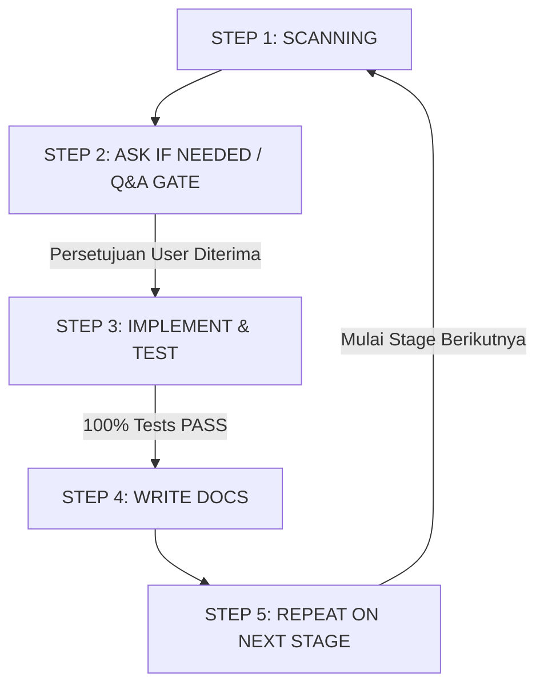

# Standard Operating Procedure (SOP) & Alur Kerja Stage – Proyek PATEN

Dokumen ini memuat siklus kerja wajib (*non-negotiable SOP*) yang harus dipatuhi secara ketat pada setiap tahapan (Stage 1 sampai Stage 6) dalam pengembangan sistem **PATEN (Pemantauan Transaksi & Efektivitas Niaga)** Kabupaten Kutai Timur.

---

## Siklus Wajib Pengerjaan Per Stage (5-Step Cycle)

Setiap pengerjaan stage wajib melalui 5 tahapan berurutan berikut:



---

### STEP 1: SCANNING (Pemindaian Menyeluruh)
Sebelum melakukan modifikasi kode apa pun pada stage yang dituju:
1. **Pemeriksaan Codebase:** Periksa status file aplikasi Laravel, struktur direktori aktif, model, controller, service, dan rute yang sudah tersedia.
2. **Inspeksi Database via MCP:** Gunakan MCP Server (`supabase-postgres`) untuk menginspeksi tabel Supabase yang relevan dengan stage tersebut, memvalidasi keberadaan kolom, tipe data, indeks, dan relasi *foreign key*.
3. **Membaca Rencana Staging:** Buka dan telaah secara mendalam dokumen rencana teknis stage aktif pada `docs/staging/stage_{X}_plan.md`.

---

### STEP 2: ASK IF NEEDED / Q&A GATE (Gerbang Konfirmasi)
Setelah langkah scanning selesai:
1. **Laporan Scanning:** Sampaikan ringkasan singkat kondisi codebase dan kesiapan skema database kepada pengguna.
2. **Klarifikasi & Pertanyaan Terbuka:** Jika ditemukan ambiguitas logika bisnis (misalnya detail aturan Perbup, kalkulasi pembobotan SPK, batas toleransi transaksi), potensi *edge-case* keamanan, atau parameter yang belum pasti, ajukan pertanyaan langsung menggunakan sarana interaktif (`ask_question`).
3. **Pemberhentian Wajib (Gate):** BERHENTI dan TUNGGU jawaban serta persetujuan resmi dari pengguna sebelum melanjutkan ke penulisan kode implementasi. Dilarang mendahului eksekusi tanpa persetujuan.

---

### STEP 3: IMPLEMENT & TEST (Eksekusi Kode & Pengujian Wajib)
Setelah pengguna memberikan persetujuan eksekusi:
1. **Implementasi Backend & Database:**
   - Bangun model Eloquent, relasi, casting atribut JSONB, mutator/accessor, dan event/observer.
   - Buat Business Services, Single-Responsibility Actions, dan Database Transactions (`DB::transaction`).
   - Terapkan keamanan endpoint via custom Middleware (`VerifyCmsTokenMiddleware`, `VerifyPosPinMiddleware`) dan proteksi rate limiting.
2. **Implementasi Raw Frontend (Inertia.js + Vue 3):**
   - Bangun halaman antarmuka fungsional murni sesuai batasan `work.md` (hanya elemen mentah `<form>`, `<input>`, `<select>`, `<button>`, `<table>` tanpa styling kosmetik).
   - Pastikan interaktivitas pengiriman payload, validasi form, dan penerimaan respons dari backend berjalan normal.
3. **Pengujian Otomatis (Automated Testing):**
   - Buat Feature Test dan Unit Test yang menguji seluruh endpoint, *authorization check*, validasi payload, integritas data di Supabase, dan logika transaksi.
   - Jalankan `php artisan test` hingga seluruh pengujian mencapai status **100% BERHASIL (`PASS`)**. Stage tidak boleh dinyatakan selesai jika masih ada test yang berstatus *failed* atau *error*.

---

### STEP 4: WRITE DOCS (Dokumentasi Implementasi & Pengujian)
Setelah seluruh test berstatus PASS:
1. **Laporan Stage Mandiri:** Buat dokumentasi hasil implementasi lengkap untuk stage tersebut pada:
   ```text
   docs/stage_{nomor}_implementation.md
   ```
   Laporan memuat: ringkasan fitur yang diselesaikan, rincian file yang dibuat/dimodifikasi, daftar endpoint API, dan bukti eksekusi test.
2. **Append ke Consolidated Testing Report:** Tambahkan (*append*) hasil log pengujian otomatis ke dalam SATU file dokumentasi testing terpusat:
   ```text
   docs/CONSOLIDATED_TESTING_REPORT.md
   ```
   *Catatan Kritis:* Seluruh rekam jejak testing dari Stage 1 hingga Stage terakhir wajib terhimpun secara kumulatif di dalam file tunggal ini.

---

### STEP 5: REPEAT ON NEXT STAGE (Transisi Siklikal)
1. Laporkan penyelesaian stage aktif kepada pengguna dengan menyertakan tautan ke file dokumentasi yang telah dibuat.
2. Berpindah ke target stage berikutnya dan mulai kembali dari **STEP 1 (SCANNING)**.
